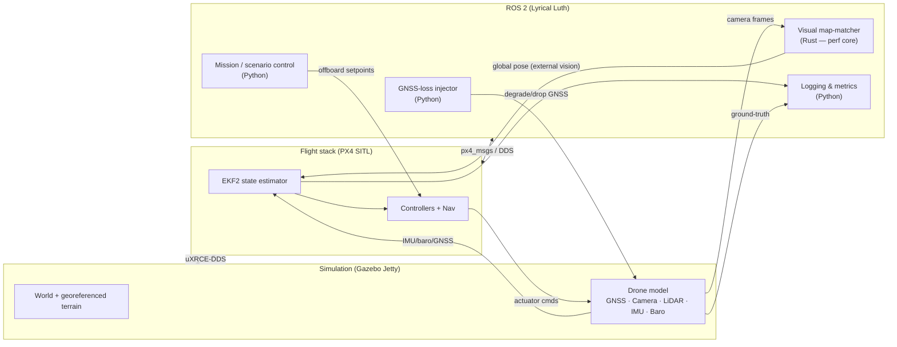

# Drone SITL — Overview Specification

> **Status:** Draft v0.1 · **Last updated:** 2026-07-17
>
> This is the top-level specification for the Drone SITL project. It defines the
> purpose, scope, architecture, and requirements. Detailed component specs live
> alongside this file under `docs/specs/` and are linked from
> [§9 Detailed specifications](#9-detailed-specifications).

---

## 1. Purpose

Drone SITL is a **Software-In-The-Loop (SITL)** simulation platform for a
multirotor drone that can **keep flying and holding position after losing its
GNSS (GPS) signal**. When GNSS degrades or drops out, the drone estimates its
**global position from its camera** by matching the live view against a
pre-built, georeferenced map of the environment (**visual map-matching**).

The project exists to develop, test, and demonstrate GPS-denied navigation
entirely in simulation — no physical hardware required — so that the perception
and estimation algorithms can be iterated quickly and reproducibly.

## 2. Goals & non-goals

### Goals
- **G1** — Simulate a quadrotor with a realistic sensor suite (GNSS, camera,
  LiDAR, IMU, barometer) in Gazebo, driven by the PX4 autopilot.
- **G2** — Fly autonomous missions commanded from ROS 2.
- **G3** — Inject controllable **GNSS degradation / loss** scenarios.
- **G4** — Estimate the drone's **global position from the camera** via visual
  map-matching, implemented as a real-time **Rust** node.
- **G5** — Fuse the visual position estimate into PX4's state estimator (EKF2)
  so the drone **maintains stable flight and position hold while GNSS is
  unavailable**.
- **G6** — Measure and visualize estimation accuracy against Gazebo
  ground-truth (position error, drift, availability).
- **G7** — Provide a **reproducible, containerized development environment**
  (Podman) so any contributor can build and run the full stack with a
  single command.

### Non-goals (for the initial version)
- Not targeting real flight hardware / HITL (Hardware-In-The-Loop). The design
  should not *preclude* it later, but it is out of scope now.
- Not building a custom flight controller — PX4 is used as-is.
- Not solving full SLAM / map-building online. The georeferenced map is built
  **offline** ahead of a mission (see [§4.6](#46-map-builder-offline)).
- Not modeling adversarial GNSS spoofing beyond simple dropout/noise injection.

## 3. System overview



**One-paragraph data flow.** Gazebo simulates the drone and its sensors. PX4
SITL runs the autopilot; it exchanges state and commands with ROS 2 over the
uXRCE-DDS bridge (`px4_msgs`). The **Rust map-matching node** consumes camera
frames, matches them against the offline-built georeferenced map, and publishes
a **global position estimate** as an external-vision pose into PX4's **EKF2**.
When GNSS is healthy, EKF2 fuses GNSS + IMU + vision; when the **Python GNSS-loss
injector** degrades or removes GNSS, EKF2 falls back to **IMU + visual
map-matching**, keeping the position estimate bounded so the drone can hold
position and continue its mission.

## 4. Components

### 4.1 Simulation layer — Gazebo Jetty
- Physics + sensor simulation. Provides the drone model and the world.
- Drone model (based on PX4's `x500` quadrotor) equipped with:
  - **GNSS** (position, with injectable noise/dropout)
  - **Camera** (downward-facing primary; forward optional) — the source for
    map-matching
  - **LiDAR** (obstacle/altitude sensing; reserved for later obstacle avoidance)
  - **IMU** and **barometer** (fused by EKF2)
- Publishes **ground-truth pose** for evaluation only (never fed to the estimator).

### 4.2 Flight stack — PX4 SITL
- Runs the PX4 autopilot as a host process (SITL), connected to Gazebo.
- **EKF2** performs sensor fusion. Configured to accept **external vision**
  pose (`VehicleVisualOdometry` / EV) so the visual estimate can substitute for
  GNSS.
- Offboard control is commanded from ROS 2 for missions.

### 4.3 ROS 2 middleware — Lyrical Luth
- `px4_msgs` + uXRCE-DDS agent bridge PX4 ↔ ROS 2.
- All project nodes are ROS 2 nodes so they compose, record (`ros2 bag`), and
  introspect uniformly.

### 4.4 Perception & estimation — Rust (performance core)
The project's core contribution. Real-time nodes written in Rust (via
[`ros2-rust`/`rclrs`](https://github.com/ros2-rust/ros2_rust), with `r2r` as a
fallback binding):
- **Feature extraction** from live camera frames.
- **Visual map-matching**: match extracted features against the offline
  georeferenced feature map to recover a **global position** (and heading).
- **Pose gating/health**: reject low-confidence matches; report an availability
  / covariance signal so EKF2 can weight it appropriately.
- Publishes the estimate on the topic EKF2 consumes as external vision.

### 4.5 Orchestration & tooling — Python (glue)
- **Mission / scenario control**: arm, take off, run a flight plan via offboard
  setpoints.
- **GNSS-loss injector**: programmatically degrade/drop the simulated GNSS on a
  schedule or trigger to create test scenarios.
- **Logging & metrics**: record estimated vs ground-truth pose, compute error
  metrics, and produce plots/reports.
- **Launch files** that bring up the whole stack.

### 4.6 Map builder (offline)
- Offline pipeline that turns a georeferenced source (orthomap / rendered world
  view) into the **feature map** used by [§4.4](#44-perception--estimation--rust-performance-core).
- Run ahead of a mission; output is a versioned artifact consumed at runtime.

## 5. Requirements

### 5.1 Functional
| ID  | Requirement |
|-----|-------------|
| FR1 | Simulate a quadrotor in Gazebo with GNSS, camera, LiDAR, IMU, and barometer. |
| FR2 | Command autonomous missions (arm → takeoff → waypoints → land) from ROS 2. |
| FR3 | Inject GNSS degradation and full dropout on demand, with configurable timing/noise. |
| FR4 | Estimate global position from the camera via visual map-matching (Rust node). |
| FR5 | Feed the visual estimate into EKF2 as external vision. |
| FR6 | Maintain stable flight and position hold while GNSS is unavailable, using the visual estimate. |
| FR7 | Record estimated vs ground-truth pose and compute accuracy/drift metrics. |
| FR8 | Visualize trajectories and errors (plots and/or RViz). |

### 5.2 Non-functional
| ID   | Requirement |
|------|-------------|
| NFR1 | **Reproducibility** — the container image is the single source of version truth; the full stack builds and runs via Podman with documented commands (`make …`). |
| NFR2 | **Performance** — map-matching runs fast enough to feed EKF2 usefully (target ≥ the camera frame rate at real-time factor 1.0; exact budget defined in the estimation spec). |
| NFR3 | **Modularity** — perception, estimation, orchestration, and simulation are separable ROS 2 packages. |
| NFR4 | **Observability** — all inter-node data is on ROS 2 topics and recordable with `ros2 bag`. |
| NFR5 | **Determinism** — scenarios (GNSS-loss timing, mission plan, seeds) are reproducible from config. |

### 5.3 Acceptance / demonstration criteria
- **AC1** — With GNSS healthy, the drone completes a waypoint mission.
- **AC2** — GNSS is dropped mid-mission; the drone continues and **holds/returns
  within a bounded position error** using only the visual estimate (target
  bound defined per-scenario in the evaluation spec).
- **AC3** — A report shows estimated-vs-ground-truth error over the flight,
  including the GNSS-loss window.

## 6. Technology stack

| Layer | Choice | Notes |
|-------|--------|-------|
| OS (container base) | Ubuntu 26.04 LTS ("Resolute Raccoon") | Matches Lyrical/Jetty support. |
| Middleware | **ROS 2 Lyrical Luth** | 2026 LTS (supported to May 2031). |
| Simulator | **Gazebo Jetty** | LTS; pairs with Lyrical via `ros-lyrical-ros-gz`. |
| Autopilot | **PX4 SITL** | EKF2 with external-vision fusion. |
| Perf core | **Rust** (stable) | Perception/estimation nodes via `rclrs`/`r2r`. |
| Glue / tooling | **Python 3.13** | Orchestration, injection, analysis, launch. |
| Containers | **Podman** + Compose | Dev/sim runtime and the source of version truth for everything *inside* the container; see `compose.yaml` / `Containerfile`. |
| Dev tooling | **mise** (`mise.toml`) | Provisions auxiliary dev tools (pre-commit, linters) on the host **and** in the container. Deliberately never pins python/rust. |
| Dev conveniences (container) | `tmux`, `git`/`gh`, Claude Code CLI | Installed in the image; host `~/.ssh`, `~/.gitconfig`, credential stores and `~/.claude` are bind-mounted so they work with the host identity. |
| Rust toolchain | **rustup** via `rust-toolchain.toml` | Pins the Rust version used by `colcon` in-container; also honored by host `rust-analyzer`. |
| Task runner | **Make** | `Makefile` wraps common workflows. |

## 7. Development environment

The environment has **two layers with a deliberate boundary**:

- **Dev tools — `mise`** (`mise.toml`) pins the tools a developer runs
  *around* the build: pre-commit and the formatters/linters it invokes. It is
  installed on the host (one-command setup) and in the dev container, so the
  same pinned versions apply in both places. It **never** pins python or rust.
- **Container — `Containerfile`** is the **authoritative runtime** and the
  single source of version truth for everything that actually runs: Ubuntu
  26.04, ROS 2 Lyrical, Gazebo Jetty, apt packages, and the **system Python**
  used by `rclpy`/`ament`/`colcon`. Because `mise.toml` carries no python/rust,
  `mise` inside the container cannot shadow the interpreter ROS 2 requires.
  The image also ships developer conveniences (`tmux`, `git`, `gh`, Claude Code
  CLI) and `compose.yaml` bind-mounts the host's `~/.ssh`, `~/.gitconfig`,
  credential stores and `~/.claude` so they run with the host identity.
- **Rust — `rust-toolchain.toml`** pins the Rust version; `rustup` honors it
  both for the in-container `colcon` build and for host-side `rust-analyzer`.
- **`Makefile`** exposes the common workflow as memorable targets, e.g.
  `make build`, `make sim`, `make run`, `make test`, `make fmt`, `make clean`.
- GUI apps (Gazebo, RViz) require X11/Wayland forwarding into the container;
  this is documented in the `README.md`.

## 8. Proposed repository layout

```text
drone-sitl-2/
├── AGENTS.md                # Guidance for AI/code agents working in this repo
├── README.md                # Quickstart & environment setup
├── Makefile                 # Developer workflow entrypoints
├── compose.yaml             # Podman Compose dev/sim environment
├── Containerfile            # Dev/sim image definition
├── mise.toml                # Dev tools (pre-commit, linters) — host + container
├── rust-toolchain.toml      # Pinned Rust toolchain (rustup)
├── docs/
│   └── specs/
│       ├── overview.md      # ← this document
│       ├── architecture.md  # (planned) detailed component/topic design
│       ├── estimation.md    # (planned) map-matching & EKF2 fusion spec
│       ├── simulation.md    # (planned) world, drone model, sensors
│       └── evaluation.md    # (planned) metrics, scenarios, acceptance
├── ros2_ws/                 # ROS 2 workspace
│   └── src/
│       ├── drone_bringup/       # (Python) launch files, params
│       ├── drone_mission/       # (Python) mission & scenario control
│       ├── gnss_injector/       # (Python) GNSS degradation/dropout
│       ├── visual_matcher/      # (Rust)   map-matching estimator
│       ├── perception_common/   # (Rust)   feature extraction, shared types
│       └── drone_eval/          # (Python) logging, metrics, plotting
├── maps/                    # Offline-built georeferenced feature maps (artifacts)
├── tools/
│   └── map_builder/         # Offline map-building pipeline
└── sim/
    ├── worlds/              # Gazebo worlds
    └── models/              # Drone & sensor models
```

> The layout is a proposal to be confirmed as components are specified; it is
> not yet implemented.

## 9. Detailed specifications

These deeper specs will be written next, each expanding on a slice of this
overview:

- `architecture.md` — node graph, ROS 2 topics/QoS, PX4↔ROS 2 message mapping.
- `simulation.md` — Gazebo world, drone model, sensor parameters, ground-truth.
- `estimation.md` — feature extraction, map-matching algorithm, EKF2 external
  vision integration, timing budget, failure handling.
- `evaluation.md` — metrics definitions, test scenarios, acceptance thresholds.

## 10. Milestones (indicative)

1. **M0 — Environment** — Podman + Make bring up an empty ROS 2 / PX4 /
   Gazebo stack; drone spawns and can be armed.
2. **M1 — Baseline flight** — Autonomous waypoint mission with GNSS healthy (FR1, FR2).
3. **M2 — GNSS injection** — Controllable GNSS degradation/dropout + logging (FR3, FR7).
4. **M3 — Visual estimate** — Offline map builder + Rust map-matcher producing a
   global pose against ground-truth (FR4, G6).
5. **M4 — Fusion** — Visual estimate fused into EKF2; position hold under GNSS
   loss (FR5, FR6).
6. **M5 — Evaluation** — Scenario suite, metrics report, acceptance criteria met
   (AC1–AC3).

## 11. Open questions

- Camera configuration: downward-only vs downward + forward for matching?
- Map representation: dense feature database vs learned descriptors vs template
  matching against an orthophoto?
- Target accuracy bound for AC2, and maximum GNSS-loss duration to support.
- ROS 2 Rust binding: standardize on `rclrs` or `r2r`?
- Do we need a HITL path later (keep PX4 message boundaries clean if so)?

## 12. Glossary

- **SITL** — Software-In-The-Loop: the autopilot runs as software against a
  simulated vehicle, no hardware.
- **GNSS / GPS** — Global Navigation Satellite System; the drone's absolute
  position source that this project makes optional.
- **EKF2** — PX4's Extended Kalman Filter state estimator.
- **External vision (EV)** — a pose estimate from an off-board source (here, the
  map-matcher) that EKF2 can fuse.
- **Visual map-matching** — recovering global position by matching the live
  camera view against a pre-built georeferenced map.
- **Ground-truth** — the simulator's exact state, used only to evaluate the
  estimator.
